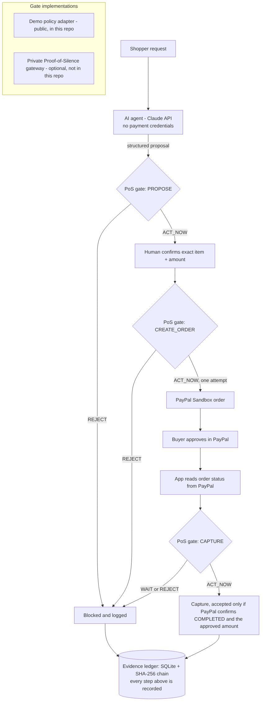

# Silent Checkout v2 — neonai.shop

An AI shopping agent that can **propose** a purchase but cannot **pay** unless a human approves the exact amount.
Every consequential step passes a gate (a public demo adapter of the Proof-of-Silence™ gate interface), a human confirms the exact item and amount,
and PayPal (Sandbox) only captures money after the buyer approved that exact amount in PayPal.
Every step lands in a tamper-evident evidence ledger you can export as CSV or JSON.

Built for the PayPal AI Hackathon 2026. **Sandbox only. No real money moves.**



## What happens

1. The shopper describes what they need in plain language.
2. The AI agent (Claude API) returns a structured proposal: item, amount, currency, reason. It sees only the
   request and the demo catalogue — never PayPal credentials.
3. Gate **PROPOSE**: the item must exist, the price must match the catalogue, the amount must be within the
   owner's budget. A prompt-injected "ignore my budget" request is blocked here (covered by tests).
4. A human confirms by typing the exact amount. The approval is bound to that item and amount.
5. Gate **CREATE_ORDER**: approval present, unchanged, unused and fresh. One attempt only.
6. PayPal Sandbox order is created; the buyer approves it in PayPal.
7. The app reads the order back from PayPal. Gate **CAPTURE** answers WAIT until the buyer approved,
   and REJECT if PayPal shows a different amount or order.
8. Capture is recorded as CAPTURED only if PayPal confirms `COMPLETED` for the approved amount.
   Anything uncertain (timeouts, odd responses, crash mid-call) is frozen as `REVIEW_REQUIRED` and never retried.

## How PayPal and AI are used

- **PayPal (Sandbox, Orders v2 REST API):** OAuth client-credentials token, `POST /v2/checkout/orders`
  (with `PayPal-Request-Id` idempotency key and buyer approval via the PayPal Sandbox checkout page),
  `GET /v2/checkout/orders/{id}` to read the buyer-approved amount back, and
  `POST /v2/checkout/orders/{id}/capture`. Code: `paypal_client.py`.
- **AI (Anthropic Claude via the Messages API):** turns a plain-language request into a structured proposal
  (`item_id`, `amount`, `currency`, `reason`) chosen from a small demo catalogue. Code: `ai_agent.py`.
  The AI module receives no PayPal credentials. `AI_PROVIDER=mock` runs fully offline.

## Verified Sandbox run (9 Nov 2026, one continuous session)

| | |
|---|---|
| Proposal | AI Risk Scanner (Standard), 9.00 EUR — demo gate `ACT_NOW` |
| Wrong confirmation | 1.00 EUR — refused (`HUMAN_APPROVAL_MISMATCH`) |
| PayPal Sandbox order | `61G66411HL478774X` |
| Capture | `3L217610BM083854W` — `COMPLETED`, 9.00 EUR |
| Ledger | 11 entries, chain intact, head `0de0466e…6b64ca` |

Exports: `docs/evidence/onetake_run_2026-11-09.json` / `.csv`. An earlier, separate Sandbox session
(order `8HE008159R316804W`, capture `2T479471T7932424S`) is kept as `docs/evidence/earlier_session_2026-11-09.*`.
Demo video: https://www.youtube.com/watch?v=lUKt2iLQk2w

## Try it as a judge

1. Follow **Run it** below. Without any keys, set `AI_PROVIDER=mock` and run `pytest -v` (PayPal is mocked).
2. With your own PayPal **Sandbox** app keys and `PAYPAL_ENABLE_CREATE=YES` / `PAYPAL_ENABLE_CAPTURE=YES`,
   run `app.py`, ask for a tool, approve the exact amount, approve in PayPal Sandbox with a sandbox buyer,
   then press *Check PayPal status* and *Capture*. Set both flags back to `NO` afterwards.
3. `preflight.py --oauth --ai` checks configuration without creating any order.

## About the gate in this repository

| | In this repo | Not in this repo |
|---|---|---|
| Gate interface (`pos_gateway.py`) | ✅ documented, `ACT_NOW` / `WAIT` / `REJECT`, fail-closed | |
| **Demo policy adapter** | ✅ small, readable rule set written for this demo | |
| Proprietary Proof-of-Silence™ engine | | ❌ private; optional via `POS_MODE=remote` |

The project is fully functional with the public demo adapter. **The demo adapter is not the proprietary
Proof-of-Silence engine** and does not claim its behaviour. A private gateway can be plugged in through the
documented HTTP contract (`RemoteGateway`); any error or unexpected answer from it is treated as REJECT.

## Run it (Windows PowerShell)

```powershell
py -3.11 -m venv .venv
.\.venv\Scripts\python.exe -m pip install -r requirements.txt
Copy-Item .env.example .env      # edit locally; never paste secrets anywhere
.\.venv\Scripts\python.exe -m pytest -v      # 28 tests, mocked PayPal, no network
.\.venv\Scripts\python.exe app.py            # http://127.0.0.1:5050
```

macOS / Linux: same with `python3 -m venv .venv` and `.venv/bin/python`.

Configuration (`.env`): `AI_PROVIDER=anthropic` + `ANTHROPIC_API_KEY` for the real agent, or `AI_PROVIDER=mock`
for an offline demo (labelled **MOCK** in the UI). PayPal Sandbox keys from developer.paypal.com.
`PAYPAL_ENABLE_CREATE` and `PAYPAL_ENABLE_CAPTURE` default to `NO`.

## Tests (mocked PayPal, mock AI)

`pytest -v` runs 28 tests: missing human approval, modified amount (before approval, after approval, inside
PayPal), reused approval, duplicate requests, 10 concurrent order attempts, invalid credentials, network
timeouts on create and capture, unexpected PayPal responses, restart with interrupted calls, ledger tampering,
unauthorised capture, AI hallucinated price / unknown item / malformed output / prompt injection, and a check that
the AI request never carries PayPal credentials. The safety checks were also mutation-tested: deliberately
breaking each of four guards makes at least one test fail.

## Known limitations

- Local demo, not production: no user accounts, no CSRF protection, binds to 127.0.0.1 only.
- Human approval means typing the exact amount for that item; it is **not** authentication of a specific
  person, and the local capture endpoint has no separate signed approval token. The demo implements
  exact-amount approval and a PayPal buyer handoff; it does not claim to make unauthorised payment
  impossible in every environment.
- The ledger is a local SHA-256 chain: it detects edits, deletions and reordering, but it is not signed or
  externally anchored, so someone with full database access could rewrite it consistently.
- No webhooks: status is read from PayPal on demand.
- The real Claude API and real PayPal Sandbox paths are implemented; see `docs/TEST_STATUS.md` for which runs
  were performed on real services.

## Licence

Apache License 2.0 (see `LICENSE`). Proof-of-Silence™ is a trademark used by Jerzy Skiba; the proprietary
engine is not licensed by this repository.

neonai.shop · Jerzy Skiba, sole trader, Dublin, Ireland
